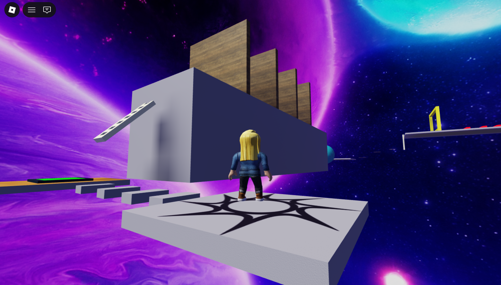
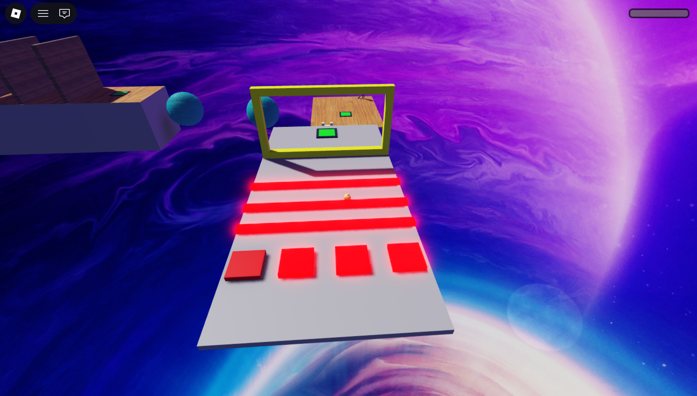
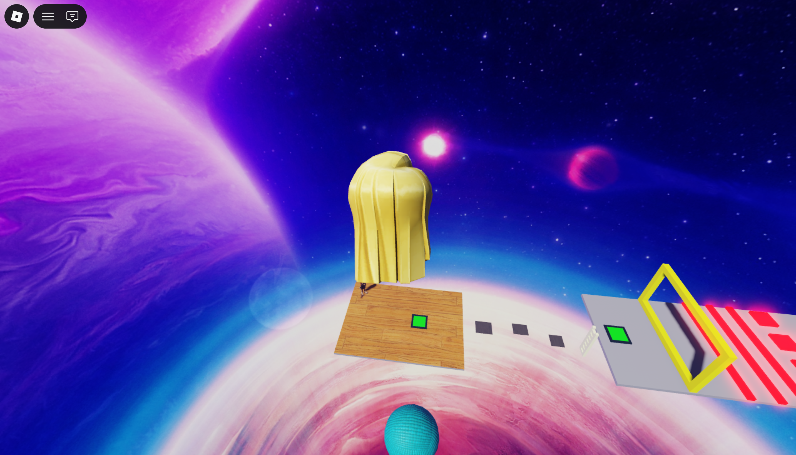
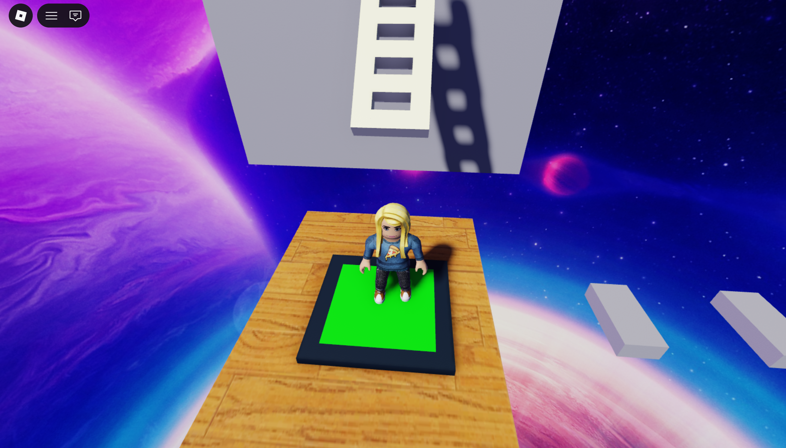

# 奇怪跑酷

一款使用 Roblox Studio 製作的跑酷闖關遊戲，也是我參考書籍、自己動手完成的遊戲設計學習作品。

## 遊戲介紹

《奇怪跑酷》以宇宙星空為背景，將平台與障礙物設置在空中。玩家需要控制角色移動與跳躍，掌握起跳時機和落地位置，穿越各種關卡，挑戰抵達終點。

遊戲中有需要操作技巧的跳躍路線、能讓角色跳得更高的特殊物件，以及碰觸後會扣血或使血量歸零的障礙物。關卡也設有重生點，讓玩家失敗後能從途中繼續挑戰。

## 遊戲特色

- **平台跳躍**：判斷平台之間的距離，控制方向與跳躍時機。
- **障礙物挑戰**：避開會造成傷害或使血量歸零的障礙物。
- **特殊跳躍效果**：利用特殊物件，讓角色跳得更高。
- **重生點設計**：在關卡途中設置重生點，方便反覆嘗試。
- **宇宙場景**：在星空與行星環繞的場景中進行跑酷。

## 遊戲畫面

### 起始畫面與關卡場景

從起點出發，挑戰空中平台與不同的障礙路線。

### 障礙物設計

紅色障礙物是關卡中的危險區域，玩家需要掌握跳躍時機，避免碰觸後血量歸零。

### 特殊跳躍效果

透過 Script 程式設定特殊物件，讓角色能跳得更高。

### 重生點設置

以綠色平台標示重生點，讓玩家在失敗後能從途中繼續挑戰。

## 使用工具與製作內容

- **開發工具**：Roblox Studio
- **程式撰寫**：在 Script 中撰寫程式，控制遊戲互動效果。
- **製作內容**：場景搭建、平台與障礙物配置、跳躍效果、傷害判定及重生點設定。

## 學習心得

這是我參考書籍製作的跑酷遊戲。透過實際搭建場景與撰寫 Script 程式，我練習了如何讓物件產生互動，以及如何將平台、障礙物和重生點組合成可以遊玩的關卡。雖然遊戲規模簡單，但讓我體驗了從設計、製作到測試的過程，也建立了 Roblox 遊戲開發的基礎。

## 參考書籍

《邊做邊玩邊學速成攻略! Roblox遊戲設計大全》

本專案為參考上述書籍完成的學習實作。
